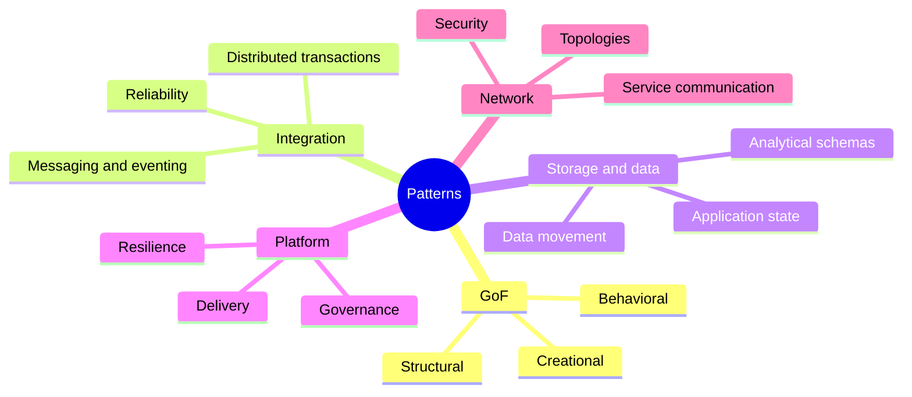
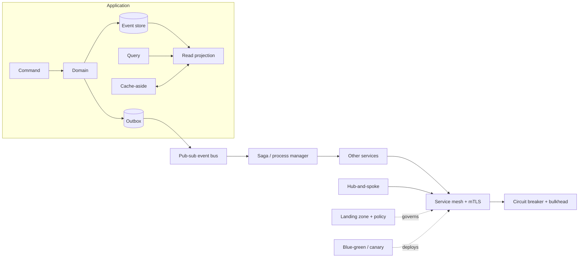

# Software Architecture & Design Patterns - Five-Strand Field Guide

A practical catalog of reusable approaches. Select patterns to address concrete needs such as change, scale, reliability, consistency, security, and autonomy.

## Overview

| Strand | Areas |
|---|---|
| GoF Design | Creational, Structural, Behavioral |
| System Integration | Messaging, eventing, distributed transactions |
| Storage & Data | Analytical schemas, application state, data movement |
| Platform Infrastructure | Compute stability, governance, deployment |
| Network | Topologies, service communication, security |

## Contents

### Strands

1. [GoF Design Patterns](strands/01-gof-design-patterns.md)
   - Creational patterns
   - Structural patterns
   - Behavioral patterns
2. [System Integration Patterns](strands/02-system-integration.md)
   - Messaging and eventing
   - Distributed transactions and reliability
3. [Storage & Data Patterns](strands/03-storage-data.md)
   - Analytical schemas
   - Application state and access
   - Data movement and quality
4. [Platform Infrastructure Patterns](strands/04-platform-infrastructure.md)
   - Compute stability and resilience
   - Governance, delivery, and operations
5. [Network Patterns](strands/05-network-patterns.md)
   - Topologies
   - Service communication and trust

### Cross-cutting topics

- [Pattern fit guide: when to use and when to avoid](topics/pattern-fit.md)
- [Foundations: theorems, principles, and trade-offs](topics/foundations.md)
- [Compute and deployment architectures: VMs, containers, and beyond](topics/runtime-architectures.md)
- [Security Architecture](topics/security-architecture.md)
- [Reliability, Availability, Integrity, and InfoSec Architecture](topics/reliability-availability-integrity-infosec.md)

# Combining patterns

A query-heavy service might use **CQRS** and projections, publish changes using a **Transactional Outbox**, distribute them through **Pub-Sub**, and coordinate cross-service work with a **Saga**. At runtime, **Sidecars**, **mTLS**, **Circuit Breakers**, and **Bulkheads** protect communication. A governed **Landing Zone** and **Canary** or **Blue-Green** delivery provide platform controls.

## Quick selection questions

1. What actually varies or fails?
2. Where is the boundary: object, process, data store, platform, or network?
3. What consistency, freshness, ordering, and duplication are acceptable?
4. Who owns the schema, event, policy, identity, runbook, and recovery?
5. How will the pattern be observed, replayed, compensated, or rolled back?

## Glossary

- **Command:** request to perform an action.
- **Event:** record of a fact that has already happened.
- **Idempotency:** repeating an operation with the same identity does not duplicate its effect.
- **Compensation:** a new action that counteracts an earlier completed action semantically.
- **Projection:** derived state optimized for a query.
- **Workload identity:** verifiable identity assigned to a running service.
- **Blast radius:** scope of impact when a component or change fails.

## Reading path

Start with the strand closest to your design question. Use the fit guide to evaluate trade-offs, the foundations chapter to understand distributed-system limits, and the runtime chapter to compare deployment models.
