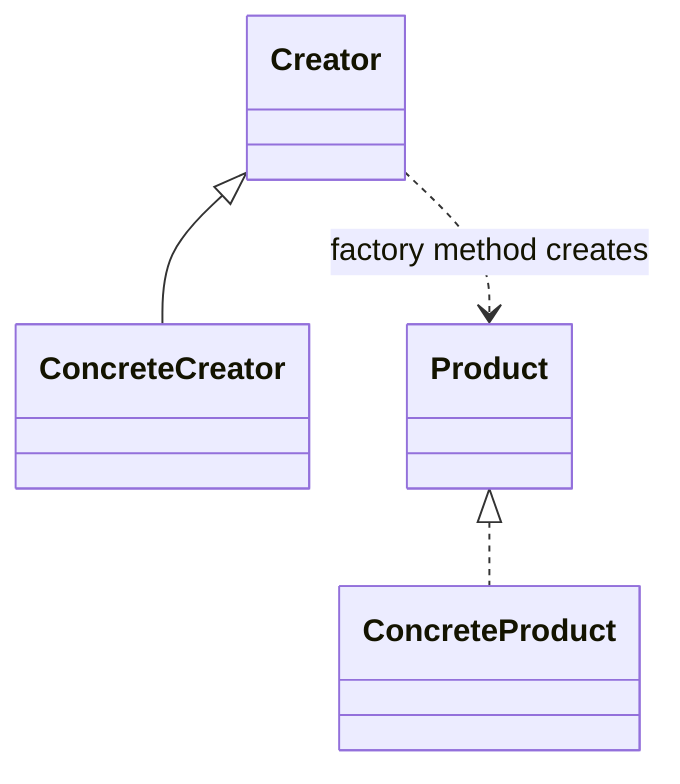
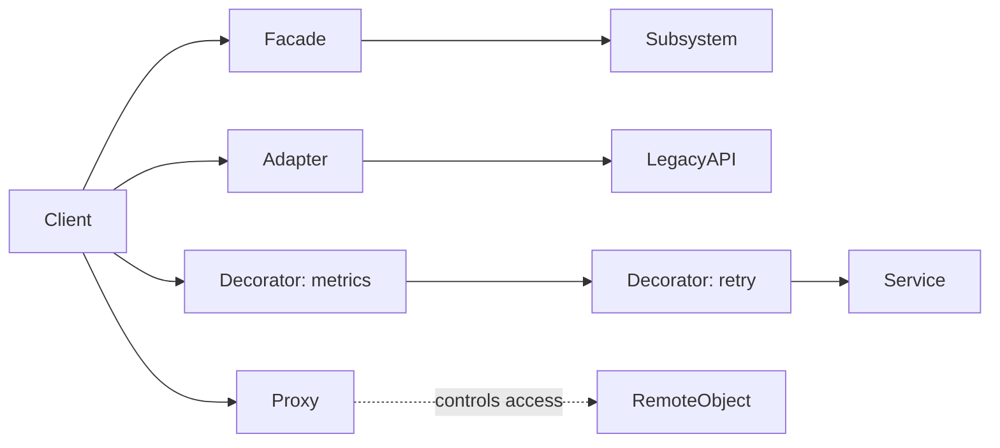
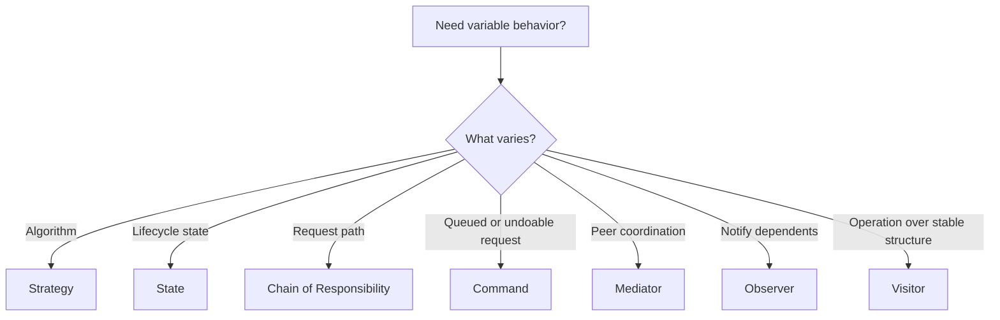

# GoF Design Patterns

[Home](../index.md) · [Pattern fit guide](../topics/pattern-fit.md) · [Foundations](../topics/foundations.md) · [Runtime architectures](../topics/runtime-architectures.md) · [Security](../topics/security-architecture.md) · [Reliability / Availability / Integrity](../topics/reliability-availability-integrity-infosec.md)

# 1. GoF Design Patterns

GoF patterns organize object creation, composition and behavior within an application process. They can affect runtime allocation and execution, but are not memory-management strategies.

## Creational

| Pattern | Intent |
|---|---|
| Abstract Factory | Create related families of objects without naming concrete classes. |
| Builder | Construct complex objects step by step; separate construction from representation. |
| Factory Method | Let a method or subtype choose which product to instantiate. |
| Prototype | Create a new object by copying a configured prototype. |
| Singleton | Ensure one instance and provide a global access point; consider dependency injection instead. |

## Structural

| Pattern | Intent |
|---|---|
| Adapter | Translate one interface into another expected by a client. |
| Bridge | Separate abstraction from implementation so each can vary. |
| Composite | Treat individual objects and object groups uniformly in a tree. |
| Decorator | Add responsibilities by wrapping an object. |
| Facade | Offer a simpler interface over a complex subsystem. |
| Flyweight | Share intrinsic state across many fine-grained objects. |
| Proxy | Stand in for another object to control access, location, or lifecycle. |

## Behavioral

| Pattern | Intent |
|---|---|
| Chain of Responsibility | Pass a request through handlers until handled or the chain ends. |
| Command | Encapsulate a request as an object for queuing, logging, or undo. |
| Interpreter | Represent and evaluate a small language or grammar. |
| Iterator | Traverse a collection without exposing its representation. |
| Mediator | Centralize interactions among collaborating objects. |
| Memento | Capture and restore object state without exposing its internals. |
| Observer | Notify dependents when an object changes. |
| State | Change behavior as internal state changes. |
| Strategy | Encapsulate interchangeable algorithms behind one interface. |
| Template Method | Define algorithm steps and let subclasses vary selected steps. |
| Visitor | Add operations across a stable object structure without modifying its classes. |

---

[Home](../index.md) · [Next](./02-system-integration.md)
