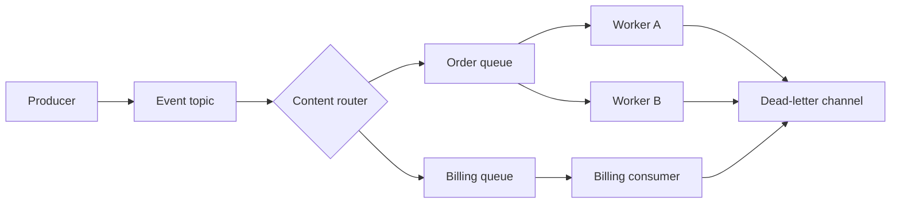

# System Integration Patterns

[Home](../index.md) · [Pattern fit guide](../topics/pattern-fit.md) · [Foundations](../topics/foundations.md) · [Runtime architectures](../topics/runtime-architectures.md) · [Security](../topics/security-architecture.md) · [Reliability / Availability / Integrity](../topics/reliability-availability-integrity-infosec.md)

# 2. System Integration Patterns

Integration patterns govern communication between processes and independently deployed components.

## Messaging and eventing

| Pattern | Intent / notes |
|---|---|
| Message Channel | Define a path through which messages flow. |
| Point-to-Point / Work Queue | Deliver each message to one logical consumer; competing workers scale processing. |
| Publish-Subscribe | Fan out events to independent subscribers without producer knowledge of each subscriber. |
| Message Router | Direct messages to destinations; variants include content-based router, recipient list and dynamic router. |
| Message Translator | Convert message structure or meaning between systems. |
| Splitter / Aggregator | Break a compound message into parts and combine correlated results. |
| Filter | Suppress messages that do not meet a condition. |
| Request-Reply | Correlate a reply to a request sent through messaging; define timeout behavior. |
| Dead Letter Channel | Isolate unprocessable messages for inspection, alerting and replay. |
| Claim Check | Store a large payload elsewhere and pass a secure reference. |
| Event Notification | Publish a minimal fact; subscribers may query for details. |
| Event-Carried State Transfer | Include enough state for consumers to update local copies. |
| Competing Consumers | Scale queue processing across workers; processing should tolerate duplicates. |



## Distributed transactions and reliability

| Pattern | Intent / trade-off |
|---|---|
| Saga | Coordinate local transactions across services with compensating actions. |
| Choreography | Services react to events to advance a saga; flow can be hard to visualize. |
| Orchestration | A coordinator directs saga steps; provides clear workflow ownership. |
| Transactional Outbox | Commit business state and outgoing message record in one local transaction; relay may publish duplicates. |
| Inbox / Idempotent Consumer | Record message identity and side effect atomically so retries do not duplicate effects. |
| Process Manager | Maintain state and route messages for a long-running process. |
| Retry with Backoff and Jitter | Retry transient failures with bounded, increasingly spaced attempts. |
| Timeout | Bound waiting time; set an end-to-end request budget. |
| Circuit Breaker | Fail fast during dependency failure and probe recovery (closed/open/half-open). |
| Bulkhead | Isolate capacity so one failure cannot consume all resources. |

```mermaid
sequenceDiagram
  participant API as Order API
  participant DB as Order DB + Outbox
  participant Relay
  participant Bus as Event bus
  participant Inv as Inventory
  participant Pay as Payments
  API->>DB: Save order and event atomically
  Relay->>DB: Read unpublished event
  Relay->>Bus: Publish OrderPlaced (may retry)
  Bus->>Inv: OrderPlaced
  Inv->>Inv: Deduplicate; reserve stock
  Inv-->>Bus: StockReserved / StockRejected
  Bus->>Pay: StockReserved
  Pay->>Pay: Deduplicate; charge
  Pay-->>Bus: PaymentSucceeded / PaymentFailed
  Note over API,Pay: Saga compensates when a step fails
```

Integration checklist: define message IDs, correlation and causation IDs, schema version, ordering scope, delivery semantics, retention, replay, poison-message policy and ownership. At-least-once delivery plus idempotent processing is a common practical choice.

---

[Home](../index.md) · [Previous](./01-gof-design-patterns.md) · [Next](./03-storage-data.md)
