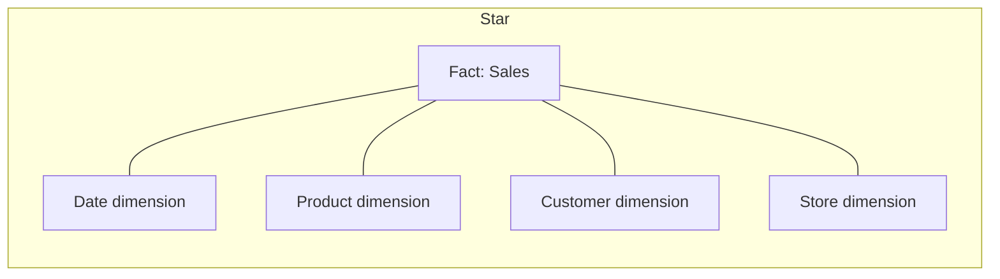
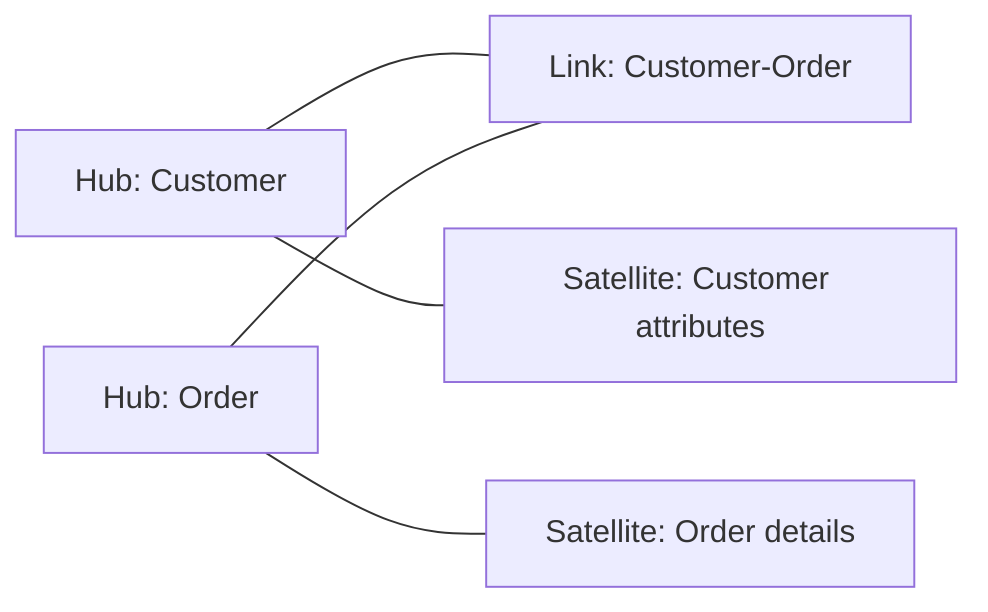
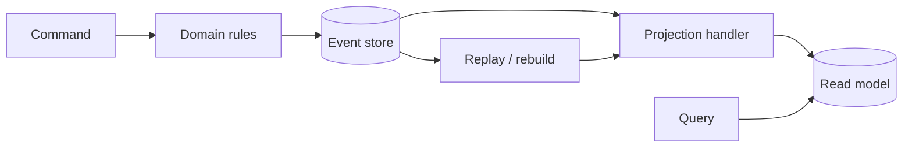
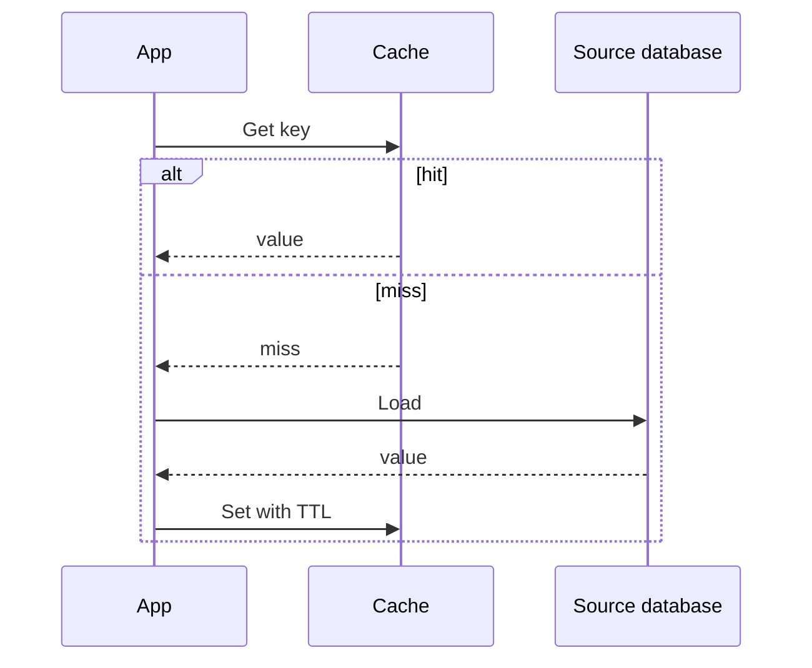

# Storage & Data Patterns

[Home](../index.md) · [Pattern fit guide](../topics/pattern-fit.md) · [Foundations](../topics/foundations.md) · [Runtime architectures](../topics/runtime-architectures.md) · [Security](../topics/security-architecture.md) · [Reliability / Availability / Integrity](../topics/reliability-availability-integrity-infosec.md)

# 3. Storage & Data Patterns

## Analytical schemas

| Pattern | Shape and strengths |
|---|---|
| Star Schema | Fact table linked to denormalized dimensions; simple analytics and efficient aggregations. |
| Snowflake Schema | Normalized dimension hierarchies; less duplication but more joins. |
| Fact Constellation / Galaxy | Multiple fact tables share conformed dimensions. |
| Data Vault 2.0 | Hubs (business keys), Links (relationships), Satellites (descriptive history); auditable and flexible, but verbose. |
| One Big Table | Flattened query-oriented representation; convenient scans with duplication and evolution costs. |
| Lakehouse | Data-lake storage with table formats and warehouse-like governance/query capabilities. |

## Application state and access

| Pattern | Intent / caveat |
|---|---|
| CQRS | Separate command/write models from query/read models; adds projection and consistency complexity. |
| Event Sourcing | Store domain events as source of truth and derive state; requires versioning, snapshots, and replay discipline. |
| Materialized View / Projection | Precompute query-oriented state; expose refresh lag. |
| Cache-Aside | Application checks cache, loads source on miss, then populates cache; define staleness and stampede policy. |
| Read-Through Cache | Cache abstraction loads from source on miss. |
| Write-Through Cache | Write cache and source synchronously; adds latency and coupling. |
| Write-Behind | Persist cache writes later; higher throughput with loss and recovery risks. |
| TTL / Invalidation | Bound or actively manage freshness; expiry does not mean immediate invalidation. |
| Snapshotting | Save state periodically to reduce event replay. |
| Optimistic Concurrency | Detect conflicts with version checks; caller must retry or resolve. |
| Sharding / Partitioning | Split data by key or range; key choice affects hot spots and cross-partition queries. |
| Polyglot Persistence | Use different stores for distinct access patterns; increases operational complexity. |

## Data movement and quality

- **CDC:** capture committed database changes from a log for downstream consumers.
- **ETL / ELT:** transform before load, or load first and transform in the target.
- **Batch processing:** process bounded data on a schedule.
- **Stream processing:** continuously process events; define windows and late-arrival behavior.
- **Lambda architecture:** combine batch and speed paths, at the cost of duplicated logic.
- **Kappa architecture:** use an event log and stream path for live processing and replay.
- **Data contracts:** define ownership, schema, semantics, access, and change policy.
- **Quality gates:** validate schema, completeness, uniqueness, freshness, and domain rules.

---

[Home](../index.md) · [Previous](./02-system-integration.md) · [Next](./04-platform-infrastructure.md)
