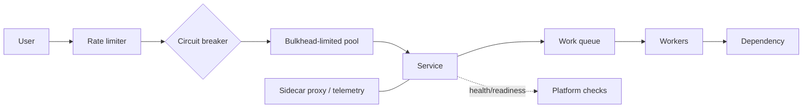
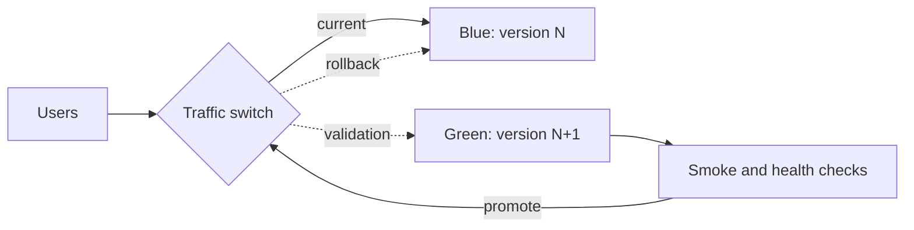

# Platform Infrastructure Patterns

[Home](../index.md) · [Pattern fit guide](../topics/pattern-fit.md) · [Foundations](../topics/foundations.md) · [Runtime architectures](../topics/runtime-architectures.md) · [Security](../topics/security-architecture.md) · [Reliability / Availability / Integrity](../topics/reliability-availability-integrity-infosec.md)

# 4. Platform Infrastructure Patterns

## Compute stability and resilience

| Pattern | Intent |
|---|---|
| Sidecar | Run a helper alongside an application for proxying, telemetry, certificates, or local caching. |
| Ambassador | Use a local proxy as representative for external services. |
| Adapter | Normalize operational or monitoring interfaces. |
| Circuit Breaker | Stop calls to an unhealthy dependency and probe recovery. |
| Bulkhead | Partition threads, queues, connections, or quotas to contain failure. |
| Health Endpoint Monitoring | Separate liveness (restart) from readiness (traffic eligibility). |
| Queue-Based Load Leveling | Buffer bursts and process at sustainable rates. |
| Retry / Backoff / Jitter | Recover from transient failures without synchronized retry storms. |
| Rate Limiting / Throttling | Bound request rate or concurrency. |
| Autoscaling | Adjust capacity using demand and saturation signals. |
| Graceful Degradation | Preserve core features when optional dependencies fail. |
| Cell-Based Architecture | Partition workloads into isolated repeatable cells to limit blast radius. |

## Governance, delivery, and operations

| Pattern | Intent / notes |
|---|---|
| Landing Zone | Governed cloud foundation for identity, networking, policy, logging, and security. |
| Account / Subscription Vending | Provision isolated environments repeatably with ownership and budget defaults. |
| Policy as Code / Guardrails | Enforce configuration rules; support explicit exception handling. |
| Infrastructure as Code | Define and review infrastructure through declarative code. |
| GitOps | Reconcile declared desired state from version control; manage secrets and emergency changes carefully. |
| Environment Promotion | Promote the same build artifact through environments to reduce drift. |
| Blue-Green Deployment | Run old and new versions side by side and switch traffic; needs extra capacity. |
| Canary Release | Expose a small traffic share to a new version, then increase based on metrics. |
| Rolling Deployment | Replace instances gradually while versions temporarily coexist. |
| Immutable Infrastructure | Replace instances from known artifacts instead of patching in place. |
| Progressive Delivery | Combine traffic shifting, canaries, and feature flags with automated analysis. |
| Observability | Combine logs, metrics, traces, and events to explain system behavior. |

---

[Home](../index.md) · [Previous](./03-storage-data.md) · [Next](./05-network-patterns.md)
