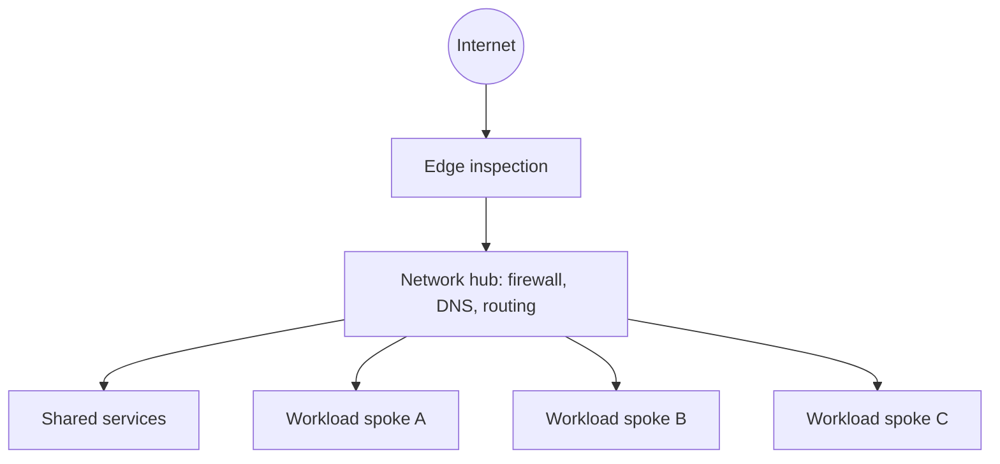
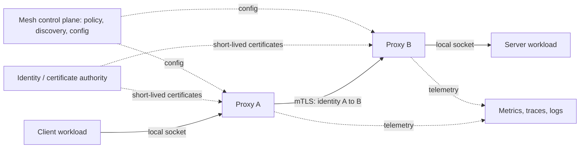

# Network Patterns

[Home](../index.md) · [Pattern fit guide](../topics/pattern-fit.md) · [Foundations](../topics/foundations.md) · [Runtime architectures](../topics/runtime-architectures.md) · [Security](../topics/security-architecture.md) · [Reliability / Availability / Integrity](../topics/reliability-availability-integrity-infosec.md)

# 5. Network Patterns

## Topologies

| Pattern | Benefits | Trade-offs |
|---|---|---|
| Hub-and-Spoke | Central inspection, shared services, controlled connectivity. | Hub capacity and availability are critical. |
| Full Mesh | Direct paths and no central bottleneck. | Connections and policy complexity grow quickly. |
| Partial Mesh | Direct connections only where useful. | Connectivity must be explicitly managed. |
| Star | Simple centralized switching or service access. | Central component is a dependency. |
| Segmentation / Zones | Separate by trust, function, or environment to limit lateral movement. | Cross-zone flows need ownership and review. |
| Ingress / Egress Gateway | Centralize inbound or outbound controls and audit. | May add latency and central load. |

## Service communication and trust

| Pattern | Intent |
|---|---|
| API Gateway | Managed client-to-service entry for authentication, quotas, routing, or composition. |
| Service Discovery | Locate healthy instances dynamically through DNS, registry, or platform facilities. |
| Load Balancing | Distribute requests across healthy instances at L4 or L7. |
| Service Mesh | Provide service-to-service traffic management, security and telemetry in a data plane. |
| Sidecar Proxy | Enforce mesh behavior beside each service; ambient mesh is another option. |
| Mutual TLS (mTLS) | Authenticate both endpoints and encrypt traffic using workload identities. |
| Zero Trust | Verify identity and policy for each access; network location alone is not trust. |
| East-West / North-South Separation | Distinguish internal service traffic from ingress/egress traffic. |
| Egress Control | Restrict and observe outbound connections. |
| Traffic Shadowing | Mirror requests to a candidate version without returning its response to users. |

## Network guardrails

- Define trust boundaries, address ownership, DNS, routing and egress before exceptions accumulate.
- Use workload identity and short-lived certificates with automated rotation.
- Apply least privilege to network policies and service identities.
- Observe latency, errors, saturation and denied flows at gateways and proxies.
- Encryption protects transport and mTLS authenticates peers; authorization policy still decides what they may do.

---

[Home](../index.md) · [Previous](./04-platform-infrastructure.md)
