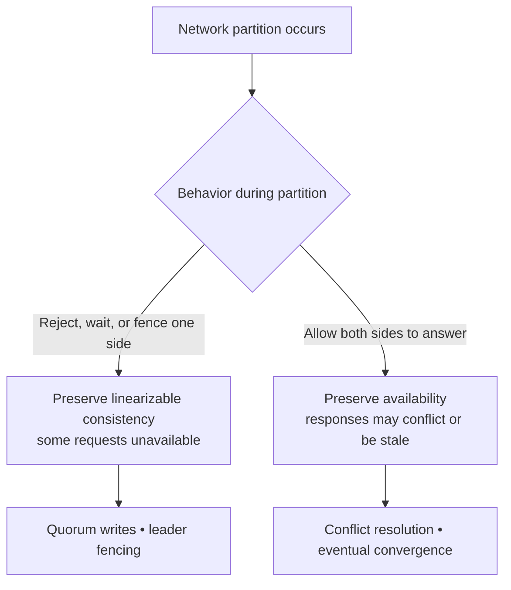
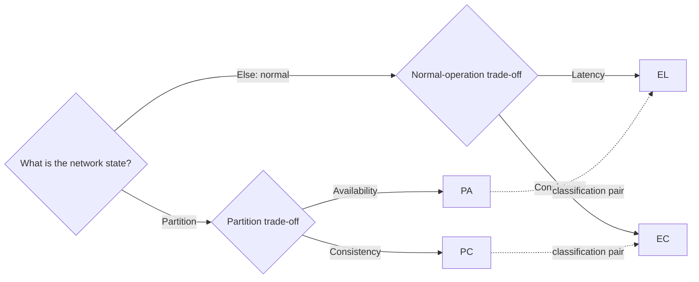
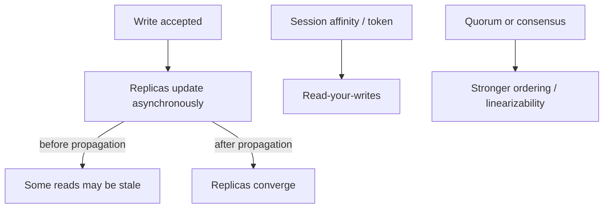
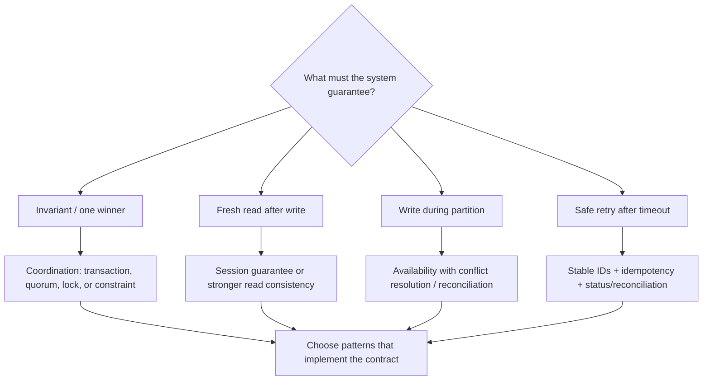

# Foundations: theorems, principles, and trade-offs

[Home](../index.md) · [Pattern fit guide](../topics/pattern-fit.md) · [Foundations](../topics/foundations.md) · [Runtime architectures](../topics/runtime-architectures.md) · [Reliability / Availability / Integrity](../topics/reliability-availability-integrity-infosec.md) · [Security](../topics/security-architecture.md)

# Foundations: theorems, principles, and trade-offs

These ideas explain constraints that architecture patterns work within. Some are formal results, some are engineering principles, and some are commonly taught shorthand. They are not interchangeable with implementation patterns.

## CAP theorem

In the formal distributed-data setting, when a network partition prevents nodes from communicating, a system cannot guarantee both **linearizable consistency** and **availability** for every request. It must reject or delay some operations to preserve consistency, or answer some operations without that guarantee to preserve availability.

CAP is specifically about behavior **during a partition**. It does not mean that a system simply picks any two of consistency, availability, and partition tolerance in normal operation. A distributed system cannot generally choose to avoid partitions; the practical design decision is how it behaves when they occur.

| Goal | Meaning in CAP discussions |
|---|---|
| Consistency (C) | Operations appear atomic and respect a single up-to-date order, commonly linearizability. |
| Availability (A) | Every request to a non-failing node receives a non-error response, though that response may be stale. |
| Partition tolerance (P) | The system continues operating despite communication loss between nodes. |

**Pattern connection:** quorum/leader approaches favor consistent decisions by refusing some operations without quorum. Multi-writer or offline-first approaches favor availability and need conflict resolution, merge rules, or eventual convergence. A cache is not automatically an AP database; its behavior depends on what it serves and how it handles partitions.

## PACELC

PACELC extends the CAP discussion with the normal-operation latency trade-off:

> If there is a **P**artition, choose between **A**vailability and **C**onsistency; **E**lse (when the system is operating normally), choose between **L**atency and **C**onsistency.

The labels **PA/PC** describe partition behavior; **EL/EC** describe the normal case. These are useful shorthand, not a complete classification of every workload or consistency guarantee.

| Design tendency | During partition | Normal operation |
|---|---|---|
| PA/EL | Favor responses on reachable sides, accepting weaker or reconcilable state. | Favor low latency, often with asynchronous replication. |
| PC/EC | Require coordination or quorum for stronger consistency. | Pay coordination latency to keep replicas in agreement. |
| Mixed | Choose per operation or data type. | Critical balances, inventory, and browsing views may use different policies. |

## FLP impossibility result

The FLP result shows that in a fully asynchronous message-passing system, where messages can be delayed without a known bound and a process may fail, no deterministic consensus algorithm can guarantee termination in every possible execution while also guaranteeing safety. It does **not** say consensus is useless or impossible in real systems. Practical systems add assumptions—timeouts, partial synchrony, failure detectors, randomized choices, or bounded environments—to make progress likely while preserving safety.

**Pattern connection:** leader election, replicated logs, and consensus-backed coordination rely on such assumptions. Timeouts can suspect failure but cannot prove a process is dead; fencing tokens and quorum rules prevent a slow former leader from continuing to act as leader.

## Gilbert–Lynch CAP result

The Gilbert–Lynch formalization of CAP establishes that a web service cannot provide both atomic/strong consistency and availability in all executions that include a network partition. It sharpens the meaning of CAP in a particular model; it is not a claim that every database has a single fixed CAP label regardless of operation, topology, and failure mode.

## CALM theorem (Consistency as Logical Monotonicity)

CALM links coordination to monotonic computation: monotonic facts can be accumulated without retracting prior conclusions, allowing coordination-free distributed computation under the theorem's assumptions. Non-monotonic decisions—such as concluding that no more matching event will arrive, enforcing a unique winner, or checking a global limit—typically need coordination or a carefully defined bounded window.

**Pattern connection:** append-only event facts and independent projections often scale with less coordination. Unique constraints, global inventory limits, and "nothing else will arrive" decisions need coordination, reservation, or explicit eventual semantics.

## Consistency models

Consistency is a contract about which values and operation orders clients may observe. "Strong" and "eventual" alone can be too vague; name the guarantee needed for each operation.

| Model | Informal guarantee | Common fit |
|---|---|---|
| Linearizability | Each operation appears to take effect atomically at one point between invocation and response, respecting real-time order. | Balances, locks, unique claims, coordination. |
| Sequential consistency | Operations appear in one total order consistent with each process's program order, but not necessarily real-time order. | Some shared-state abstractions where real-time ordering is unnecessary. |
| Causal consistency | Causally related operations are seen in causal order; concurrent operations may be seen differently. | Social feeds, collaborative workflows, distributed documents. |
| Session guarantees | A client's own reads/writes have properties such as read-your-writes or monotonic reads. | User-facing systems needing coherent per-session behavior. |
| Eventual consistency | If updates stop and communication resumes, replicas eventually converge; interim reads may differ. | Replicated views, catalogs, and asynchronously propagated state. |
| Read-your-writes | A client sees its own successful write on subsequent reads. | Profile/settings updates and user-facing forms. |
| Monotonic reads | Once a client has observed a value, later reads do not move to an older value. | Feeds and session-scoped experiences. |
| Monotonic writes | A client's writes are applied in program order. | Per-user or per-aggregate update streams. |
| Bounded staleness | A read may lag by a stated time or version bound. | Dashboards and replicated query stores with explicit freshness SLOs. |

## ACID and BASE

These are broad transaction and system design descriptions, not strict opposites.

- **ACID** describes transaction properties: atomicity, consistency (invariant preservation), isolation, and durability.
- **BASE** is a shorthand for Basically Available, Soft state, and Eventual consistency, often used to describe systems that accept temporary inconsistency and converge.
- A system can use ACID transactions within a service and eventual consistency across services. A Saga plus local ACID transactions is a common example.
- ACID's "consistency" means transactions preserve declared data invariants; it is different from CAP's replica consistency.

## End-to-end principle

Functions that require application-level knowledge are often best implemented at the endpoints, even when lower layers offer partial support. Lower layers can still help, but they cannot fully replace end-to-end validation.

Examples: a successful network write does not prove a business record was durably stored; transport checksums do not validate business meaning; a broker acknowledgment does not prove the consumer's business effect completed.

**Pattern connection:** use application acknowledgments, idempotency keys, durable outboxes/inboxes, and end-to-end reconciliation for critical workflows. Infrastructure retries and monitoring complement these guarantees.

## Fallacies of distributed computing

These are reminders of assumptions that fail in distributed systems. The list is often attributed to L. Peter Deutsch and others; exact wording varies.

1. The network is reliable.
2. Latency is zero.
3. Bandwidth is infinite.
4. The network is secure.
5. Topology does not change.
6. There is one administrator.
7. Transport cost is zero.
8. The network is homogeneous.

Design implications include timeouts, bounded payloads, authentication, retries with idempotency, service discovery, explicit ownership, and protocol/version compatibility. These are not a checklist to implement mechanically; each should lead to a concrete failure assumption and mitigation.

## Two Generals and common knowledge

The Two Generals problem illustrates that over an unreliable channel, acknowledgments of acknowledgments cannot create absolute common knowledge that a message was received. In practical systems, this means a sender can be uncertain after a timeout: the receiver may have completed the action while the acknowledgment was lost.

**Pattern connection:** use stable operation IDs, idempotent commands, status queries, and reconciliation rather than assuming that a timeout means "nothing happened."

## End-to-end delivery and "exactly once"

A broker may offer exactly-once processing within a defined broker transaction boundary, but that does not automatically make an external database update, email, payment, or arbitrary side effect exactly once. End-to-end effects usually require deduplication, idempotency, transactional boundaries, and reconciliation.

| Term | Practical meaning |
|---|---|
| At-most-once | A message/effect is not repeated, but may be lost. |
| At-least-once | A message/effect is retried until acknowledged; duplicates are possible. |
| Effectively-once | Repeated delivery is made safe through idempotency/deduplication within a defined scope. |
| Exactly-once | A precise guarantee within a clearly stated system boundary; do not imply it across independent systems without proof. |

## Little's Law

For a stable system, average number of items in the system (**L**) equals arrival rate (**λ**) multiplied by average time in the system (**W**): **L = λW**. It applies to long-run averages under its assumptions, not as a promise for short bursts.

**Why it matters:** growing queue depth at a fixed arrival rate means items are spending longer waiting or processing. Use queue depth and age alongside throughput and latency; scaling consumers helps only if the downstream dependency can handle the extra load.

## Fallacies about time and ordering

Wall clocks on different machines can drift, jump, and disagree. Timestamps alone do not establish causality or a total order. Use per-aggregate sequence numbers, broker partition offsets, logical clocks, or consensus-backed ordering where the requirement demands them. Hybrid logical clocks can combine physical-time intuition with logical ordering, but are not a substitute for a clear domain ordering contract.

## How the foundations guide pattern choice

| Requirement / constraint | Patterns or techniques to examine |
|---|---|
| Strong invariant across concurrent writers | Local transaction, unique constraint, optimistic/pessimistic concurrency, quorum/consensus, reservation. |
| Continue accepting writes while disconnected | Multi-writer replication, offline-first design, conflict-free merge where applicable, reconciliation. |
| Reduce user-visible stale reads | Read-your-writes/session tokens, sticky routing, synchronous replication, bounded-staleness contract. |
| Safely retry uncertain operations | Idempotency key, inbox, transactional outbox, status endpoint, reconciliation. |
| Survive slow or failing dependencies | Deadline propagation, timeout, circuit breaker, bulkhead, queue, graceful degradation. |
| Scale independent event-derived views | Pub-sub, append-only event log, projections, schema contracts, replay. |
| Make a multi-service workflow auditable | Saga/process manager, correlation IDs, durable state, compensation, operations dashboard. |

## Quick caveats

- CAP does not say "pick any two" in everyday design; focus on behavior during a partition.
- PACELC adds a normal-operation latency/consistency choice, but is still a simplification.
- Eventual consistency promises convergence under assumptions, not a time bound unless one is specified.
- A timeout means the caller does not know the outcome; it does not prove the operation failed.
- A local ACID transaction does not make a distributed workflow atomic.
- Message ordering is usually scoped (for example, per partition or aggregate), not global.
- Stronger consistency may be needed for some operations and unnecessary for others; express the required contract per operation.

---

[All strands](../index.md)
