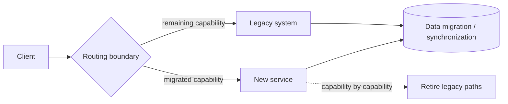
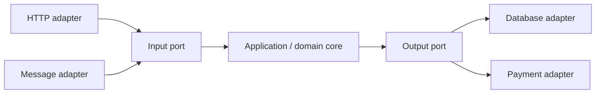
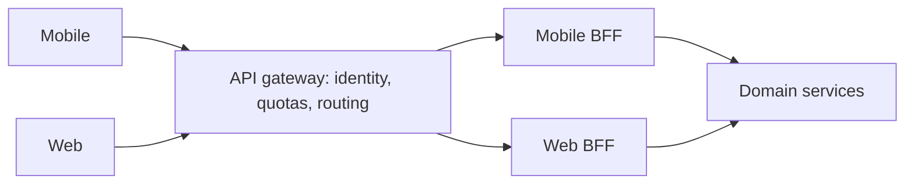
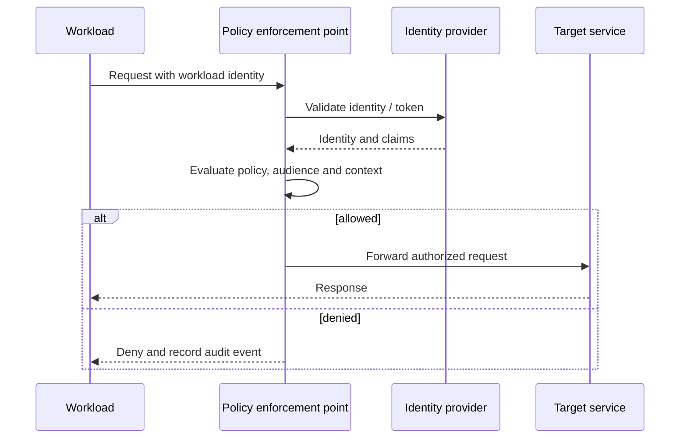
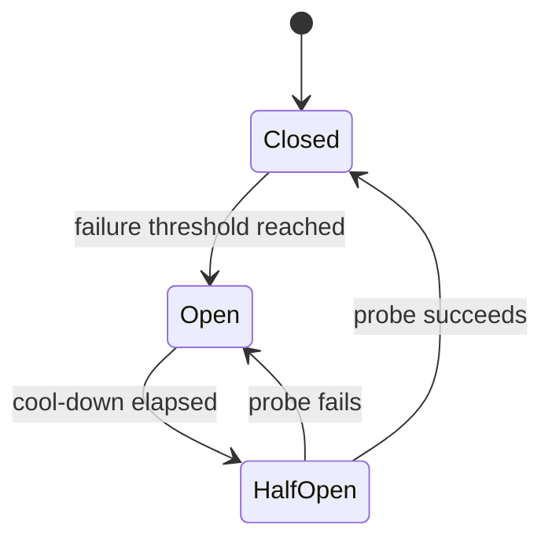

# Pattern fit guide

[Home](../index.md) · [Pattern fit guide](../topics/pattern-fit.md) · [Foundations](../topics/foundations.md) · [Runtime architectures](../topics/runtime-architectures.md) · [Reliability / Availability / Integrity](../topics/reliability-availability-integrity-infosec.md) · [Security](../topics/security-architecture.md)

# Pattern fit guide: when to use and when to avoid

Use these criteria as prompts for design discussion. A pattern should earn its added concepts, runtime components and operational work by solving a real problem.

## GoF patterns

### Creational

| Pattern | Use when | Avoid when |
|---|---|---|
| Abstract Factory | Callers need interchangeable families of related products, such as provider-specific clients. | There is only one product family or the abstraction hides meaningful provider differences. |
| Builder | Construction has many optional or ordered steps, or the result should be immutable. | The object is simple enough for a constructor or record literal. |
| Factory Method | Subclasses or plugins must choose a product while preserving a common workflow. | A small factory function or dependency injection is clearer. |
| Prototype | Copying a configured object is cheaper or safer than rebuilding it. | Copy semantics are ambiguous, objects contain shared mutable state, or construction is cheap. |
| Singleton | Exactly one process-scoped instance is a genuine invariant. | Global state harms tests, multi-tenant isolation, lifecycle control, or parallel execution. |

### Structural

| Pattern | Use when | Avoid when |
|---|---|---|
| Adapter | An existing API cannot be changed but must satisfy a target interface. | You control both interfaces and can align them directly; avoid adapters that silently discard semantics. |
| Bridge | Two independent dimensions of variation would otherwise create many subclasses. | The abstraction and implementation do not vary independently. |
| Composite | Clients should apply the same operation to leaves and nested groups. | Tree semantics are artificial or leaf/group operations differ substantially. |
| Decorator | Responsibilities should be combined dynamically and transparently. | Wrapping order becomes hard to understand or a simple explicit pipeline would be clearer. |
| Facade | Callers need a stable, smaller surface over a complex subsystem. | The facade becomes a catch-all service or prevents access to necessary subsystem capabilities. |
| Flyweight | Many objects share large amounts of immutable intrinsic state. | Memory pressure is not demonstrated or shared/extrinsic state makes identity confusing. |
| Proxy | Access, lifecycle, locality, or expensive loading must be controlled behind the same interface. | The proxy hides network latency/failure or introduces surprising behavior. |

### Behavioral

| Pattern | Use when | Avoid when |
|---|---|---|
| Chain of Responsibility | Several handlers may process a request and the chain order is meaningful. | Every request needs one obvious handler or silent fall-through is dangerous. |
| Command | Requests need queuing, retries, logging, undo, or delayed execution. | A direct function call is sufficient and command objects add ceremony. |
| Interpreter | The language is small, stable and benefits from a domain-specific syntax. | The grammar is broad or performance-critical; use a parser/compiler toolchain. |
| Iterator | Clients need uniform traversal without collection internals. | The collection already exposes a clear iteration protocol. |
| Mediator | Peer-to-peer coordination has become tangled and can be owned by one coordinator. | The mediator becomes a god object or interactions are already simple. |
| Memento | A bounded state snapshot is needed for undo or restore without exposing internals. | State is huge, external side effects cannot be restored, or event history is more appropriate. |
| Observer | Multiple in-process dependents react to state changes. | Delivery must survive process failure; use durable messaging instead. |
| State | A finite set of states changes valid operations and transitions. | There are few states with no state-specific behavior; simple conditionals are clearer. |
| Strategy | An algorithm varies independently and should be selected at runtime or injected. | There is only one stable algorithm or selection logic becomes more complex than the algorithm. |
| Template Method | A stable algorithm has a few extension steps controlled by subclasses. | Composition or dependency injection is needed, or inheritance makes changes brittle. |
| Visitor | Operations change more often than a stable object structure. | The structure changes frequently or adding a new variant should be easy. |

## System integration and messaging patterns

| Pattern | Use when | Avoid when |
|---|---|---|
| Message Channel | You need an explicit, governed communication path. | A direct in-process call is sufficient and asynchronous semantics add no value. |
| Point-to-Point / Work Queue | Each task should be handled by one worker and buffered independently of producer speed. | Every subscriber needs its own copy or strict global order is required. |
| Publish-Subscribe | Several independent consumers need the same business fact. | The operation is a command that must have one accountable owner or subscriber count is trivial. |
| Message Router | Routing rules are explicit and destinations vary by message. | Routing requires opaque business logic scattered across a central bottleneck. |
| Content-Based Router | Stable message fields can select destinations. | The router must inspect sensitive payloads unnecessarily or rules change unpredictably. |
| Recipient List | A message should fan out to a dynamically determined set. | All recipients must complete atomically; use explicit workflow tracking instead. |
| Message Translator | Integrating systems have different schemas or vocabularies. | Translation loses important meaning or a shared contract is genuinely viable. |
| Splitter / Aggregator | Independent subrequests can run in parallel and a combined result is meaningful. | Partial results, timeouts and correlation cannot be handled clearly. |
| Filter | Irrelevant messages can be safely discarded at a known boundary. | Suppressed messages need audit, replay, or explanation and no record is kept. |
| Request-Reply | A response is needed but messaging transport is required. | The caller expects immediate low-latency semantics and synchronous HTTP/RPC is simpler. |
| Dead Letter Channel | Failed messages need isolation and later inspection or replay. | It becomes an unmonitored graveyard with no ownership, retention, or recovery process. |
| Claim Check | Payload size is large or sensitive and a reference is safer to transport. | Reference lifecycle, authorization and cleanup cannot be guaranteed. |
| Event Notification | Consumers only need to know that something happened and can retrieve details. | Consumers need stable historical facts or must avoid a follow-up query. |
| Event-Carried State Transfer | Consumers need local copies and low-latency reads. | Payloads expose sensitive data, change too often, or create unacceptable staleness. |
| Competing Consumers | Work can be processed independently and horizontally. | Tasks must be serialized per key but no partitioning/ordering mechanism exists. |
| Saga | A business transaction spans services and can tolerate eventual completion plus compensation. | Strong atomicity is mandatory or compensation is impossible and unacceptable. |
| Choreography | The workflow is short, event-driven and teams can trace the event flow. | The process has many branching steps, timers, or complex recovery behavior. |
| Orchestration | A long-running workflow needs centralized state, visibility, deadlines, or compensation. | The coordinator becomes a shared bottleneck or hides service ownership. |
| Transactional Outbox | A service writes to a database and must reliably publish corresponding messages. | The data store and broker support a proven atomic transaction together and outbox overhead is not justified. |
| Inbox / Idempotent Consumer | Broker delivery can repeat and effects must not duplicate. | Message identity is unstable or the side effect cannot be made atomic/idempotent. |
| Process Manager | A multi-step process must retain state and react to messages over time. | The process is a simple stateless transformation. |
| Retry with Backoff and Jitter | Errors are transient and retry is safe within a bounded deadline. | Failures are permanent, requests are non-idempotent, or retries will overload a struggling dependency. |
| Timeout | Any remote or blocking operation needs a bounded wait. | Almost never avoid; choose a value based on end-to-end budgets, not arbitrary defaults. |
| Circuit Breaker | A remote dependency fails slowly or repeatedly and callers need fast failure/recovery probing. | Calls are local/reliable or breaker state can obscure a required durable retry workflow. |
| Bulkhead | Workloads or dependencies compete for finite resources. | Capacity is unlimited in practice or excessive isolation strands resources. |

## Storage, data and consistency patterns

| Pattern | Use when | Avoid when |
|---|---|---|
| Star Schema | Business users need straightforward dimensional analytics. | Workload is transactional or the dimensional model cannot represent required history. |
| Snowflake Schema | Dimension hierarchies are large/reused and normalization matters. | Query simplicity and scan performance are more important than reduced duplication. |
| Fact Constellation | Multiple processes share conformed dimensions for cross-process analysis. | Conformed dimensions cannot be governed consistently. |
| Data Vault | Raw history, auditability, source traceability and flexible ingestion are central. | Small reporting needs do not justify its modeling and downstream transformation overhead. |
| One Big Table | A known analytical workload benefits from pre-flattened reads. | Data duplication, updates, or schema changes dominate. |
| Lakehouse | Diverse analytical data needs shared lake storage plus table governance and SQL access. | Strong OLTP transactions or low-latency point updates are the primary requirement. |
| CQRS | Read and write workloads or models differ materially and can tolerate projection lag. | The domain is CRUD-simple and duplicated models would add needless complexity. |
| Event Sourcing | Events are valuable business evidence and replay/audit are core requirements. | Current state is sufficient, event evolution is unsupported, or the team cannot operate projections and replay. |
| Materialized View / Projection | Read queries are expensive or require a shape different from the source. | Data must always be current and refresh cost exceeds query savings. |
| Cache-Aside | Read-heavy data can tolerate a defined stale window and the application can manage misses. | Cache must be the source of truth or invalidation/freshness cannot be bounded. |
| Read-Through Cache | Cache platform can own loading and consistent cache behavior is reusable. | Application-specific loading logic or authorization is difficult to express in the cache layer. |
| Write-Through Cache | Cache freshness on writes is important and synchronous write latency is acceptable. | Cache availability should not affect writes or the source update cannot be coordinated. |
| Write-Behind | High write throughput is worth delayed persistence and the system has durable recovery. | Acknowledged data loss is unacceptable or ordering/replay guarantees are weak. |
| TTL | A bounded freshness window is enough and eventual expiration is acceptable. | Immediate revocation or precise invalidation is required. |
| Cache Invalidation | Updates need fresher cached values than TTL alone provides. | Many writers and regions make invalidation less reliable than short-lived caching or no cache. |
| Snapshotting | Replaying a long event history is too slow. | Snapshot versioning and rebuild validation are not implemented. |
| Optimistic Concurrency | Conflicts are uncommon and can be detected/retried with version tokens. | Contention is high and repeated retries create livelock; consider serialization or partition ownership. |
| Sharding / Partitioning | Dataset or throughput exceeds a single node and a stable partition key exists. | Cross-shard queries/transactions dominate or the projected scale does not justify complexity. |
| Polyglot Persistence | Distinct workloads genuinely need different storage properties. | Team lacks operational capacity or duplicated data ownership is unclear. |
| CDC | Downstream systems need committed changes with low latency and source-log capture is supported. | Consumers need business semantics not present in row-level changes. |
| ETL / ELT | Data must be transformed and loaded under clear governance. | Transformations have no ownership, quality checks, or lineage. |
| Batch Processing | Latency can be scheduled and throughput/cost efficiency matters. | Decisions require immediate event response. |
| Stream Processing | Continuous low-latency decisions or event-derived state are required. | Event volume and operational skills do not justify streaming infrastructure. |
| Lambda Architecture | Separate batch accuracy and low-latency paths are both required and reconcilable. | Duplicate logic is too costly; a single capable stream path can serve both. |
| Kappa Architecture | An immutable log permits replay through one stream-processing model. | Source data cannot be replayed or retention is insufficient. |
| Data Contracts / Quality Gates | Multiple producers and consumers need explicit schema and quality expectations. | Contracts are ceremonial and have no compatibility checks or ownership. |

## Platform, deployment and operations patterns

| Pattern | Use when | Avoid when |
|---|---|---|
| Sidecar | A helper should share workload lifecycle/network namespace but remain separately deployable. | Extra containers increase resource use and a platform-native capability already solves the need. |
| Ambassador | An application benefits from a local proxy that abstracts external connectivity. | Proxy behavior is invisible to developers or duplicates a service mesh/gateway. |
| Infrastructure Adapter | Legacy operational interfaces need normalization. | It becomes a permanent translation layer without a migration path. |
| Health Endpoint Monitoring | Orchestrators need readiness and liveness decisions. | Checks depend on every downstream service and cause restart loops during partial outages. |
| Queue-Based Load Leveling | Producers burst faster than workers can safely process. | Results must be synchronous or queue delay violates business deadlines. |
| Rate Limiting / Throttling | Protect capacity, enforce quotas, or provide fair access. | Limits are blind to service health or important workloads receive no priority policy. |
| Autoscaling | Demand varies and capacity signals predict useful scaling. | Startup is too slow, dependencies cannot scale, or scaling oscillates without guardrails. |
| Graceful Degradation | Core behavior remains useful when optional capabilities fail. | Returning stale or partial data would create unsafe decisions. |
| Cell-Based Architecture | Blast-radius isolation and independent scaling justify partitioning tenants/workloads. | Workload is too small or cross-cell coordination dominates. |
| Landing Zone | Multiple teams need consistent secure cloud foundations and self-service. | One-off workloads do not need a governed multi-account model or the platform team cannot maintain it. |
| Account / Subscription Vending | New environments should be repeatable, owned and policy-compliant. | Provisioning is manual by exception and no lifecycle/cleanup process exists. |
| Policy as Code | Rules should be testable, versioned and continuously enforced. | Policies are unclear or exceptions have no documented owner and expiry. |
| Infrastructure as Code | Environments need repeatable, reviewable provisioning. | State ownership and drift handling are unresolved. |
| GitOps | Desired state should be auditable and reconciled from source control. | Secrets, emergency changes, or non-declarative systems are unmanaged. |
| Environment Promotion | The same artifact can move through validation stages. | Rebuilding per environment changes the artifact or environments are not representative. |
| Blue-Green Deployment | Fast traffic switch and rollback matter and duplicate capacity is available. | Stateful migrations are incompatible or cost cannot support parallel stacks. |
| Canary Release | Risk can be reduced by incremental exposure with reliable metrics. | Traffic is too low/noisy to evaluate or rollback is not automated. |
| Rolling Deployment | Instances can be replaced gradually with compatible mixed versions. | Incompatible protocol/data changes require all-at-once coordination. |
| Immutable Infrastructure | Reproducible instances and drift reduction are priorities. | Images are not maintained or urgent patching cannot be delivered promptly. |
| Progressive Delivery | Release risk should be managed using flags, traffic steps and automated analysis. | Ownership of flags and cleanup is absent. |
| Observability | Operators need to explain behavior across distributed boundaries. | Telemetry lacks sampling, privacy, cost and retention controls. |
| SLOs / Error Budgets | Reliability should be measured against user-visible objectives and guide release pace. | Metrics do not represent user experience or leadership will not act on the budget. |
| Disaster Recovery | Recovery time and data-loss objectives require tested backup/failover plans. | Backups are untested or dependencies cannot be restored in the stated objectives. |
| Chaos Engineering | Resilience assumptions need controlled validation. | There is no steady-state metric, rollback, or safe experiment boundary. |

## Network and security patterns

| Pattern | Use when | Avoid when |
|---|---|---|
| Hub-and-Spoke | Shared inspection, services and controlled inter-spoke paths are useful. | Hub throughput/availability or routing complexity becomes a bottleneck. |
| Full Mesh | A small set of nodes needs direct, low-hop connectivity. | Node count grows and policy/certificate management becomes unwieldy. |
| Partial Mesh | Only selected pairs need direct connectivity. | Connectivity rules are undocumented or hard to test. |
| Star Topology | Central switching/service simplifies a small network. | Central dependency needs high availability that cannot be provided. |
| Segmentation / Zones | Different trust levels or environments require isolation. | Rules are so broad that segmentation is only nominal. |
| Ingress / Egress Gateway | Central policy, audit and inspection are required. | Gateway is a single bottleneck or bypass paths remain unmanaged. |
| API Gateway | External clients need a controlled API entry point and cross-cutting policies. | Internal east-west traffic is forced through a central gateway unnecessarily. |
| Service Discovery | Instances change dynamically and callers need healthy endpoints. | Static endpoints are stable and a registry adds needless moving parts. |
| Load Balancing | Requests should distribute across healthy instances. | Session/state assumptions prevent safe distribution or health checks are misleading. |
| Service Mesh | Many services need consistent identity, telemetry and traffic controls. | A small system does not justify mesh resource and operational overhead. |
| Sidecar Proxy | Per-workload traffic policy should be implemented locally. | Sidecar count/resource overhead is excessive or ambient/host proxy fits better. |
| mTLS | Both workloads need cryptographic identity and encrypted transport. | Certificate lifecycle is unmanaged or TLS is mistaken for authorization. |
| Zero Trust | Access should be continuously evaluated from identity and policy. | It is used as a product label without inventory, identity and enforcement. |
| East-West / North-South Separation | Internal service traffic and edge traffic need different controls. | Traffic classification is inconsistent or creates unowned exceptions. |
| Egress Control | Outbound destinations need policy, visibility, or data-exfiltration protection. | Allow lists are stale and block critical dependency recovery. |
| Traffic Shadowing | New versions need realistic read-only validation. | Requests cause side effects, expose sensitive data, or add unsafe load. |
| OAuth 2.0 / OIDC | Delegated authorization and user/service identity federation are needed. | Tokens are treated as secrets with no expiry, audience, or validation policy. |
| Secrets Management | Credentials need controlled storage, access, rotation and audit. | Secrets remain in source control, images, or logs. |
| Least Privilege | Access can be narrowed by identity, action and resource. | Permissions are broad defaults never reviewed. |

## Cloud application, API and architecture patterns

| Pattern | Use when | Avoid when |
|---|---|---|
| Strangler Fig | Incrementally replace a legacy system behind a routing boundary. | There is no stable seam or old/new data ownership cannot be reconciled. |
| Anti-Corruption Layer | Protect a domain model from an external or legacy system's semantics. | It simply renames every field and adds no meaningful translation. |
| Backend for Frontend (BFF) | Distinct clients need tailored APIs and release cadence. | Each client backend duplicates most business logic. |
| API Composition | A response must combine data owned by multiple services. | It becomes a high-latency fan-out or hides a missing domain boundary. |
| External Configuration Store | Runtime configuration must be centrally managed independently of deployment. | Configuration changes are unvalidated or secrets are stored as ordinary settings. |
| Consumer-Driven Contract | Providers need executable evidence of consumer expectations. | Contracts replace end-to-end behavior testing or are not run in delivery pipelines. |
| API Versioning | Incompatible public contract changes require coexistence. | Versions multiply without a deprecation and migration policy. |
| Idempotency Key | Clients may retry commands that must not execute twice. | Keys are not scoped, retained, or bound to request meaning. |
| Pagination / Cursor | Large result sets need bounded retrieval and stable continuation. | Offset semantics are required but cursor is used without an ordering guarantee. |
| Hexagonal Architecture (Ports and Adapters) | Domain logic should remain independent of frameworks and external systems. | Layers become ceremonial or the application is a small simple CRUD service. |
| Modular Monolith | A single deployment is desirable while domain modules need clear boundaries. | Teams require independent deployment/scaling and modular boundaries are not enforced. |
| Bounded Context | A domain has distinct language, rules and ownership boundaries. | Boundaries are drawn only by technical layers or teams cannot define contracts. |
| Domain-Driven Design | Complex business rules and domain collaboration justify a shared model. | The domain is simple and modeling overhead exceeds business value. |
| Leader Election | One active coordinator is needed among replicas. | Fencing, split-brain handling and lease expiry cannot be implemented safely. |
| Failover | A standby resource should take over after primary failure. | Replication lag or promotion semantics violate data-loss requirements. |
| Graceful Shutdown | Workloads need time to stop accepting work and finish in-flight operations. | Shutdown hooks wait forever or orchestration deadlines are not coordinated. |
| Backend-for-Frontend plus API Gateway | Central policy and client-specific composition both matter. | Both layers duplicate routing, auth and transformation responsibilities. |

# Extended pattern diagrams

## Strangler Fig migration

## Hexagonal architecture

## API gateway and BFF

## Zero-trust request path

## Resilience and recovery lifecycle

# Further design guidance

- Pair every asynchronous workflow with a way to inspect its current state and recover stuck work.
- Treat retries, timeouts, circuit breakers and bulkheads as one resource-protection policy, not isolated toggles.
- Design database migrations for mixed-version operation during rolling, canary and blue-green releases.
- Separate authentication (who is calling) from authorization (what that caller may do).
- Document pattern-specific failure modes and operational ownership alongside architecture diagrams.
- Prefer the smallest pattern set that meets measured requirements; patterns add ongoing costs as well as benefits.

---

[All strands](../index.md)
