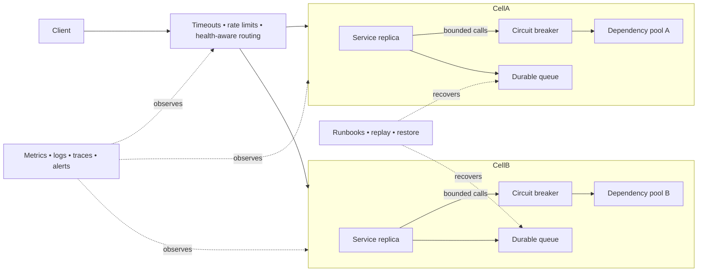
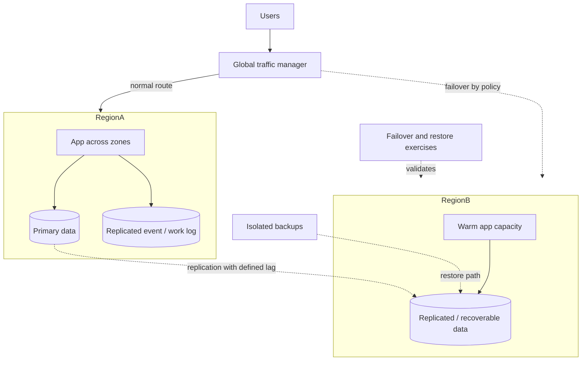
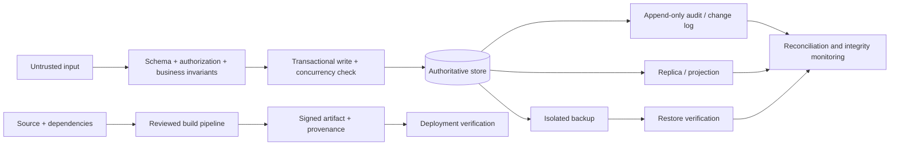
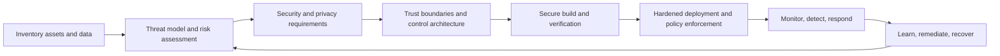

# Reliability, Availability, Integrity and InfoSec Architecture

[Home](../index.md) · [Security Architecture](security-architecture.md) · [Pattern fit guide](pattern-fit.md)

This chapter makes four cross-cutting concerns explicit. They overlap but answer different questions:

- **Reliability:** Does the system perform its intended function correctly over time?
- **Availability:** Is the system usable when needed, including during faults and maintenance?
- **Integrity:** Are data, software, configuration and operations accurate, complete and protected from unauthorized or accidental change?
- **Information Security (InfoSec):** How does the system protect confidentiality, integrity and availability while supporting authenticity, accountability and privacy?

## Reliability architecture

Reliability is an end-to-end property. It depends on application behavior, dependencies, infrastructure, data, operators and recovery-not simply having multiple servers.

### Reliability tactics

| Tactic | Architectural role | Useful measures |
|---|---|---|
| Fault isolation | Limit failure propagation through bulkheads, cells, quotas and dependency boundaries. | Blast radius, correlated failure rate. |
| Fault detection | Identify unhealthy components with meaningful readiness, liveness, synthetic checks and telemetry. | Detection time, false positive rate. |
| Fault containment | Use timeouts, circuit breakers, bounded queues, backpressure and load shedding. | Queue age, saturation, dependency timeout rate. |
| Fault recovery | Retry safely, fail over, restart, replay, compensate, or restore from backup. | Recovery time, failed recovery attempts. |
| Redundancy | Remove single points of failure across instances, zones, regions and dependencies as justified. | Failure-domain coverage, failover success. |
| Data durability | Persist and replicate critical state; verify backups and restore procedures. | Data loss, restore time, corruption detection time. |
| Graceful degradation | Preserve essential user journeys while optional capabilities are impaired. | Core transaction success during dependency failure. |
| Change safety | Use staged rollout, canary analysis, rollback and compatible schema migrations. | Change failure rate, rollback time. |
| Operational learning | Use incident reviews, runbooks, game days and controlled resilience exercises. | Repeat incident rate, action completion. |

### Reliability reference view

**Use this architecture when** failures can propagate across dependencies, data loss has material impact, or users depend on predictable end-to-end behavior.

**Avoid** adding retries, replicas, or failover without defining the failure modes they address. Redundancy can increase correlated failure, retry load, split-brain risk and operational complexity.

## Availability architecture

Availability is usually defined from a user-visible service boundary and a time window. It is not equivalent to server uptime. A service can be "up" while critical operations fail or become too slow.

### Availability design choices

| Concern | Architectural choices |
|---|---|
| Failure domains | Place independent replicas across separate hosts, zones, or regions; verify that dependencies and control planes are also independent. |
| Traffic routing | Use health-aware load balancing, DNS/global routing and explicit failover criteria. |
| Data replication | Choose synchronous or asynchronous replication according to consistency, latency and recovery objectives. |
| Maintenance | Use rolling, blue-green, or canary release with backward-compatible migrations. |
| Overload | Apply admission control, rate limits, load shedding, queueing and priority classes. |
| Degraded modes | Define which features remain available when dependencies or data are stale. |
| Disaster recovery | Define backup, restore, warm/cold standby, regional failover and return-to-primary procedures. |
| Dependencies | Track dependency availability budgets; avoid assuming a chain is as available as its most reliable component. |

### SLOs and recovery objectives

- **SLI (Service Level Indicator):** measured user-facing behavior, such as successful requests, latency, or freshness.
- **SLO (Service Level Objective):** target for an SLI over a defined window, for example successful requests over 30 days.
- **SLA (Service Level Agreement):** an external commitment, often with consequences; it should be based on achievable SLOs.
- **Error budget:** tolerated unreliability under an SLO, used to balance release speed and reliability work.
- **RTO (Recovery Time Objective):** maximum targeted time to restore service after disruption.
- **RPO (Recovery Point Objective):** maximum targeted data loss measured in time.
- **MTTR / MTTD:** mean time to repair/recover and mean time to detect; use alongside user impact and distribution percentiles.

Availability arithmetic is meaningful only when scope and measurement are clear. Serial dependencies reduce end-to-end availability; redundancy helps only if failures are sufficiently independent and failover works.

### Regional availability and disaster recovery

**Use active-active** when low recovery time is essential, traffic can be safely distributed and multi-region data consistency is designed. **Use warm standby or pilot light** when lower cost is more important and the RTO allows provisioning or scaling during recovery.

**Avoid** declaring a recovery region without testing data promotion, identity, DNS, secrets, quotas, dependencies and operator access. A replica is not a backup; replication can reproduce deletion or corruption.

## Integrity architecture

Integrity means data and system artifacts remain correct, complete, attributable and protected against unauthorized or accidental changes. It spans input, processing, storage, replication, deployment and audit.

### Integrity controls

| Control | Protects | Design notes |
|---|---|---|
| Validation and invariants | Business and data correctness at boundaries. | Validate at the trusted service boundary; use database constraints as a final guard where possible. |
| Transactions and concurrency control | Atomic updates and conflict detection. | Define transaction scope; use unique constraints, version checks, or serialization for invariants. |
| Checksums / hashes | Accidental corruption or content change. | A hash alone does not prove who produced content; authenticate the hash when adversarial tampering matters. |
| Digital signatures / MACs | Authenticity and tamper detection. | Protect keys, define rotation and verification policy and include relevant metadata in signed content. |
| Append-only / tamper-evident logs | Change history and accountability. | Restrict administrative deletion, protect signing keys and define retention and privacy constraints. |
| Replication validation | Divergence or corruption across copies. | Monitor lag and checksums; define authoritative copy and conflict resolution. |
| Backup verification | Recoverability and completeness. | Restore-test backups; isolate credentials and copies from production compromise. |
| Artifact signing and provenance | Software/build integrity from source to deployment. | Verify at deployment and protect signing identities. |
| Separation of duties | High-impact changes and sensitive approvals. | Keep approval independent and auditable without blocking routine safe operations. |
| Reconciliation | Missing, duplicated, or inconsistent effects across systems. | Use stable identifiers, compare authoritative records and provide repair workflows. |

### Data integrity flow

**Use stronger integrity controls** for financial balances, entitlements, regulated records, safety data, configuration and software supply chains.

**Avoid** relying on checksums alone for authenticity, event logs alone for correctness, or replication alone for recoverability. Define what is authoritative and how errors are detected and repaired.

## InfoSec architecture

Information Security architecture translates risk and policy into enforceable controls across identity, data, networks, applications, infrastructure, delivery and operations. It complements the detailed [Security Architecture chapter](security-architecture.md).

### Security architecture layers

| Layer | Typical controls |
|---|---|
| Governance and risk | Asset inventory, classification, threat models, policy, exception handling, control ownership. |
| Identity | Federation, MFA, workload identity, least privilege, privileged access, credential lifecycle. |
| Network | Segmentation, ingress/egress control, mTLS, DDoS protection, private connectivity. |
| Application and API | Secure defaults, input/output validation, authorization, abuse protection, dependency controls. |
| Data | Classification, minimization, encryption, key management, retention, deletion, backup isolation. |
| Platform and runtime | Hardened images, patching, isolation, configuration policy, host protection, runtime limits. |
| Software supply chain | Protected source, reviewed changes, dependency inventory, signed artifacts, provenance, deploy verification. |
| Detection and response | Audit logs, alerting, incident playbooks, containment, evidence, recovery exercises. |

### CIA and related security properties

| Property | Architecture question | Example controls |
|---|---|---|
| Confidentiality | Who can read data and how is disclosure limited? | Least privilege, encryption, segmentation, data minimization, redaction. |
| Integrity | Who can change data or artifacts and how is change detected? | Constraints, signatures, audit trails, change control, reconciliation. |
| Availability | Can authorized users access critical functions during faults or attack? | Redundancy, DDoS protection, capacity limits, recovery plans, graceful degradation. |
| Authenticity | Can users verify who or what is communicating? | MFA, OIDC, workload identity, certificate validation, signed artifacts. |
| Accountability | Can actions be attributed and investigated? | Centralized tamper-evident audit, correlation IDs, privileged session records. |
| Privacy | Is personal data limited to appropriate purposes and retention? | Minimization, access controls, purpose tracking, deletion workflows. |

The CIA properties share controls: encryption helps confidentiality and may support integrity when authenticated modes are used; backups support availability and integrity; audit supports accountability and incident response. No single control provides complete protection.

### InfoSec architecture lifecycle

## Mapping quality goals to patterns

| Goal | Patterns and practices to consider |
|---|---|
| Reliable processing despite transient faults | Timeouts, retries with idempotency, circuit breakers, bulkheads, outbox/inbox. |
| High service availability | Redundancy across failure domains, health-aware routing, queueing, load shedding, tested failover. |
| Low data-loss recovery | Synchronous replication where appropriate, durable logs, isolated backups, restore tests, explicit RPO. |
| Correct concurrent updates | Database constraints, optimistic concurrency, serializable transactions, quorum/consensus when necessary. |
| Detect unauthorized change | Signatures, MACs, immutable/tamper-evident audit, artifact provenance, reconciliation. |
| Protect sensitive data | Classification, least privilege, encryption, key management, minimization, retention controls. |
| Limit attack and failure spread | Segmentation, cells, bulkheads, egress policy, separate administrative trust boundaries. |
| Recover from compromise | Credential revocation, containment, clean rebuild, isolated backups, incident playbooks, tested break-glass access. |

## Review questions

1. What user-visible operation defines service availability and how is it measured?
2. What are the SLO, RTO and RPO for each critical capability and dataset?
3. Which failures are independent and where are shared dependencies or control planes?
4. What is authoritative for each important fact and how are corruption and divergence detected?
5. Which identities can read, change, deploy, administer and recover each asset?
6. How are keys, credentials, backups, logs and software artifacts protected?
7. What happens during partial outage, partition, overload, compromise and failed recovery?
8. Which failure and security assumptions are tested through restore drills, failover exercises and incident simulations?
