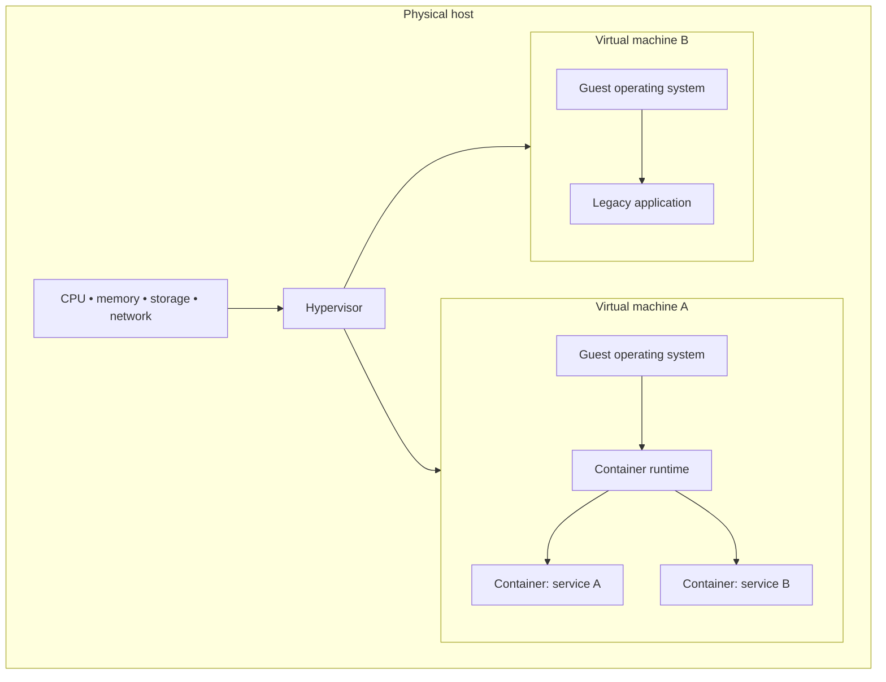
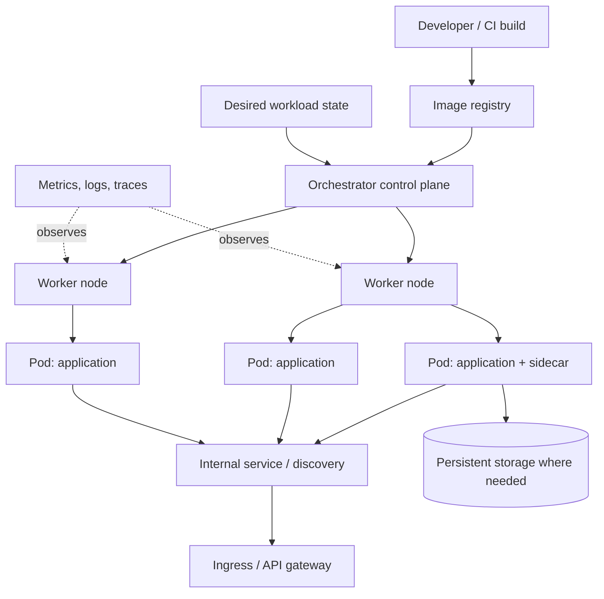
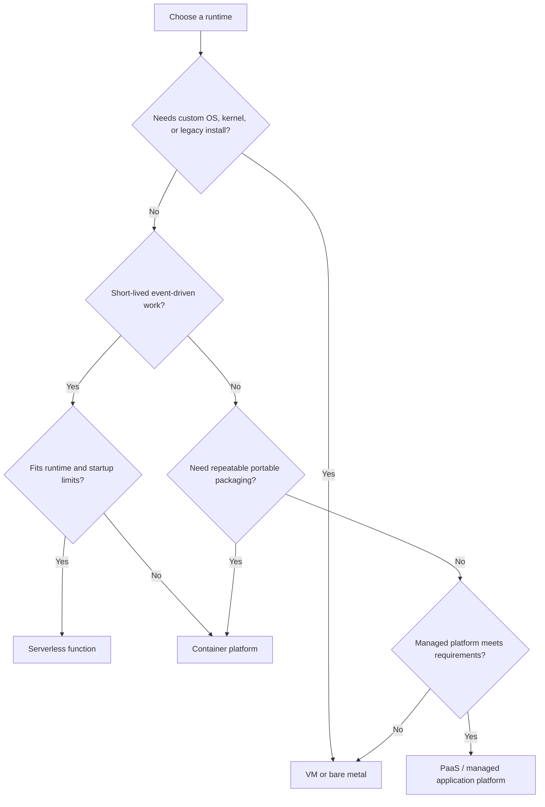

# Compute and deployment architectures

[Home](../index.md) · [Pattern fit guide](../topics/pattern-fit.md) · [Foundations](../topics/foundations.md) · [Runtime architectures](../topics/runtime-architectures.md) · [Reliability / Availability / Integrity](../topics/reliability-availability-integrity-infosec.md) · [Security](../topics/security-architecture.md)

# Compute and deployment architectures: VMs, containers and beyond

These are runtime and deployment choices rather than GoF-style patterns. They can be combined: containers often run inside VMs and serverless functions may run on container-based infrastructure behind a managed platform.

## Runtime model comparison

| Architecture | What it provides | Good fit | Costs and cautions |
|---|---|---|---|
| **Bare metal** | Application runs directly on physical hardware, with an operating system installed on the host. | Specialized hardware, predictable high performance, licensing constraints, or workloads needing direct device access. | Slow provisioning, hardware lifecycle work, weaker workload isolation unless additional layers are used and capacity can be harder to share. |
| **Virtual machine (VM)** | Hypervisor presents virtual hardware; each VM runs its own guest operating system and applications. | Stronger OS-level isolation, legacy applications, mixed operating systems, custom kernels/drivers and long-lived servers. | More memory/storage overhead per guest OS, slower boot than a container and image/patch sprawl without lifecycle automation. |
| **Container** | Processes are packaged with application dependencies and share the host kernel, isolated using OS mechanisms. | Portable services, repeatable builds, high-density deployments, fast scale-out and CI/CD. | Shared-kernel boundary is different from a VM security boundary; state, networking, image supply chain and orchestration need design. |
| **Container on VM** | Containers run on VM hosts, often in a cluster. | Common cloud setup combining VM-level isolation with container packaging and scheduling. | Two layers need capacity, patching, security and troubleshooting ownership. |
| **Serverless function** | Provider runs short-lived, event-triggered code and manages much of the infrastructure. | Bursty event handlers, scheduled jobs, glue code and workloads with variable or low utilization. | Runtime limits, cold starts, provider coupling, observability differences and unsuitable long-running/stateful workloads. |
| **Managed application platform / PaaS** | Platform abstracts servers and often runtime patching, deployment, scaling and health management. | Teams focused on application delivery with conventional web/service workloads. | Less control over host/runtime details, platform constraints and service-specific cost or portability trade-offs. |
| **WebAssembly runtime** | Sandboxed WebAssembly modules run in a host runtime, sometimes outside browsers. | Portable plugins, constrained extensions, edge workloads, or multi-language components with a narrow host interface. | Ecosystem and system integration may be more limited than containers; validate networking, persistence and observability needs. |

## Use and avoid guidance

| Choice | Use when | Avoid when |
|---|---|---|
| Bare metal | Measured workload needs direct hardware access or tightly controlled performance. | Elastic capacity, rapid replacement, or broad multi-tenant density matters more. |
| VM | Workload needs its own guest OS, legacy compatibility, kernel customization, or a stronger isolation boundary. | Fast high-density scale-out is important and OS-level isolation is sufficient. |
| Container | Build-once/run-consistently packaging and rapid deployment are valuable. | The application depends on mutable host state, has unsupported kernel assumptions, or container operations cannot be supported safely. |
| Serverless | Work is event-driven, bounded in duration and demand is spiky or unpredictable. | Continuous high utilization, long-running work, strict low-latency startup, or specialized runtime control dominates. |
| PaaS | A managed runtime meets requirements and reducing infrastructure operations is valuable. | The platform cannot satisfy required protocols, networking, compliance, or tuning constraints. |
| WebAssembly | A small, portable sandboxed module needs controlled host capabilities. | The workload relies on broad OS access or mature libraries unavailable in the target runtime. |

## VM and container layering

Containers on one host generally share the host kernel; they package user-space dependencies rather than a complete guest OS. A VM includes a guest OS. Isolation strength depends on configuration and platform implementation, so do not treat these as identical security boundaries.

## Container platform architecture

A container orchestration platform schedules workloads across machines and helps maintain desired state. It does not remove the need to design health, data persistence, network boundaries, identity, resource limits, or upgrades.

## Stateful and stateless workloads

- **Stateless service:** a request can be handled by any healthy replica because durable state is stored elsewhere or carried with the request. This is usually straightforward to scale horizontally.
- **Stateful service:** identity, ordering, local data, or durable state is tied to an instance or storage volume. It may need stable identity, ordered upgrades, replication, backups and recovery procedures.
- Containers do not make an application stateless. Container replacement is expected; persist required data outside an ephemeral container filesystem or explicitly accept its loss.
- A database can run in containers, but the operator must still own storage performance, backup, restore, replication, upgrades and failure testing. Managed database services may be a better fit.

## Runtime selection path

## Deployment shapes

| Deployment shape | Description | Suitable situations |
|---|---|---|
| Single VM / single instance | One deployable instance on one host. | Development, small internal tool, or a workload with accepted downtime. |
| VM fleet behind a load balancer | Multiple replaceable VM instances serve traffic. | Traditional applications needing OS control and horizontal redundancy. |
| Container service | Managed container instances with platform health and scaling. | Service deployments without requiring full cluster control. |
| Container orchestration cluster | Scheduler places and reconciles many workloads across nodes. | Many services, varied scaling needs and teams able to operate platform abstractions. |
| Function/event architecture | Events invoke independent functions or managed handlers. | Event-driven integration and bursty background processing. |
| Hybrid | Different runtime models coexist and integrate over explicit contracts. | Migration, edge/cloud split, legacy integration, or distinct workload needs. |

## Runtime architecture decision checklist

- Define workload shape: request/response, batch, event-driven, interactive, stateful, or latency-sensitive.
- Specify isolation and compliance requirements, including kernel, tenant and data boundaries.
- Measure CPU, memory, disk, network, startup and scaling behavior instead of selecting from fashion.
- Decide who owns patching, image provenance, secrets, runtime upgrades, backups and incident response.
- Plan graceful shutdown, readiness, liveness, resource limits and capacity headroom.
- Keep durable state outside ephemeral instances unless the runtime and recovery design explicitly support local state.
- Include total operating cost: compute, platform operations, observability, network transfer, licensing and engineering effort.

---

[All strands](../index.md)
