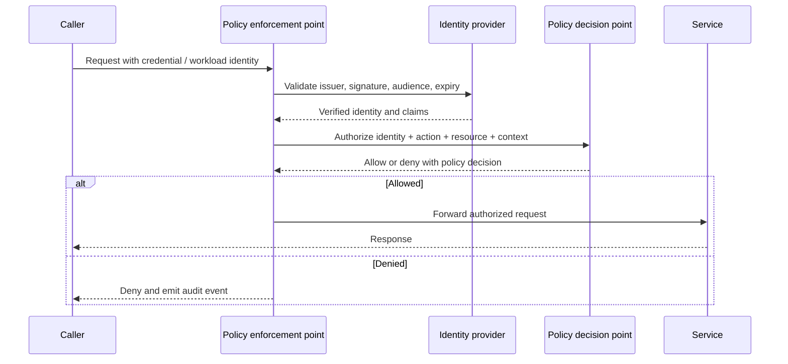
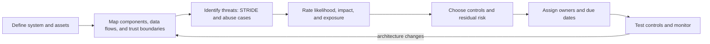
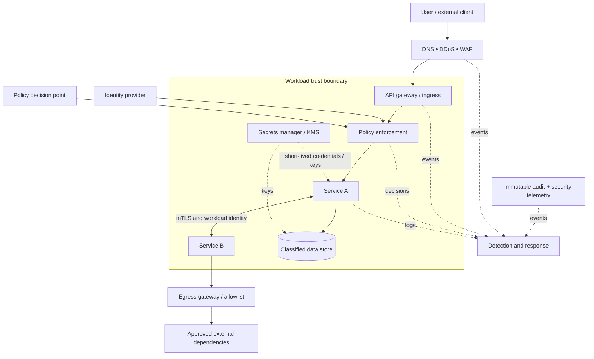

# Security Architecture

[Home](../index.md) · [Pattern fit guide](pattern-fit.md) · [Foundations](foundations.md) · [Runtime architectures](runtime-architectures.md) · [Reliability, Availability, Integrity, and InfoSec Architecture](reliability-availability-integrity-infosec.md)

Security architecture organizes identities, trust boundaries, controls, data protection, and detection across a system. Treat it as a set of verifiable design decisions spanning people, workloads, networks, software, and operations.

## Security architecture goals

- **Confidentiality:** information is disclosed only to authorized identities.
- **Integrity:** data and software are protected from unauthorized change.
- **Availability:** services and data remain usable within agreed recovery goals.
- **Authenticity and accountability:** actions are attributable to identities and produce useful audit evidence.
- **Privacy:** collection, use, retention, and disclosure follow purpose and policy.

Security controls should be selected from threat models, legal and business requirements, and likely failure modes. A diagram is not evidence that a control is enforced.

## Core security patterns

| Pattern | Use when | Avoid when |
|---|---|---|
| Defense in Depth | A single control can fail and multiple independent barriers reduce risk. | Layers are duplicated without clear owners, or controls create false confidence. |
| Least Privilege | Users and workloads can be limited to required actions, resources, and duration. | Broad administrator roles are used for convenience or left permanently assigned. |
| Zero Trust | Network location alone cannot establish trust; each access needs identity and policy evaluation. | It is treated as a product label without identity inventory, enforcement, and telemetry. |
| Security Segmentation / Zones | Workloads have different trust levels, sensitivity, or exposure. | Network zones exist on paper but broad rules permit unrestricted lateral movement. |
| Secure by Default | New resources and services should start with safe settings. | Defaults are bypassable or create operationally unsafe lockouts without a recovery path. |
| Fail Securely | A control failure should deny sensitive actions or fall back to a defined safe mode. | Fail-closed behavior would create a greater safety or availability hazard without a reviewed alternative. |
| Assume Breach | Design for containment, detection, and recovery even after prevention fails. | The principle is used to excuse missing preventive controls. |
| Separation of Duties | Sensitive actions need independent authorization or review. | Approval steps have no meaningful independence or block routine low-risk work. |
| Secure Enclave / Isolation Boundary | Sensitive computation needs a stronger isolation boundary or dedicated host/tenant. | The boundary's actual threat model and side-channel limits are not understood. |

## Identity, authentication, and authorization

| Pattern / control | Use when | Avoid when |
|---|---|---|
| Federated Identity (OIDC / SAML) | Users authenticate through a trusted identity provider and central lifecycle controls. | Issuer, audience, redirect URI, signing keys, and token validation are not strictly checked. |
| OAuth 2.0 Delegated Authorization | A client needs scoped access to an API on behalf of a user or workload. | OAuth access tokens are mistaken for proof of user authentication without OIDC. |
| Workload Identity | Services need credentials tied to workload identity rather than embedded long-lived secrets. | Identity claims are too broad, trust relationships are unmanaged, or token audiences are unchecked. |
| RBAC | Permissions align with stable job or service roles. | Roles proliferate or users need many exceptions; consider attributes/conditions. |
| ABAC / Policy-Based Access | Decisions depend on identity, resource, action, and context attributes. | Attribute quality is poor or policy logic cannot be tested and explained. |
| Just-in-Time Privilege | Elevated access is needed temporarily for operations. | Elevation is not time-limited, approved, audited, or protected with strong authentication. |
| Policy Decision / Enforcement Points (PDP/PEP) | Authorization decisions should be centralized and consistently enforced at service boundaries. | Enforcement can be bypassed or the decision point becomes an unbounded availability dependency. |
| Privileged Access Management | Administrative credentials and sessions need controlled checkout, approval, and recording. | Shared admin accounts remain the normal operating model. |

### Authentication and authorization flow

## Data protection and secrets

| Pattern / control | Use when | Avoid when |
|---|---|---|
| Data Classification | Handling requirements vary by sensitivity, regulation, or business impact. | Labels have no owners, handling rules, or enforcement. |
| Encryption in Transit | Data crosses a network or untrusted boundary. | It is treated as sufficient security while endpoints and authorization remain weak. |
| Encryption at Rest | Storage media, backups, or snapshots may be accessed outside the trusted boundary. | Keys are stored beside data or all consumers share one uncontrolled key. |
| Envelope Encryption / KMS | Data keys need centralized key protection, rotation, and audit. | Key ownership, recovery, and rotation impacts are not designed. |
| Secrets Manager | Credentials require controlled access, rotation, and audit. | Secrets are still copied to source, images, logs, or developer machines unnecessarily. |
| Tokenization / Redaction | Sensitive values should not be exposed to downstream systems or logs. | Tokens are reversible without controls or redaction damages required evidence. |
| Data Minimization and Retention | Only required data should be collected and kept for a defined period. | Retention rules conflict with legal holds or recovery requirements without resolution. |
| Privacy by Design | Systems process personal data and need purpose limitation and user rights support. | Privacy review happens only after data flows are already fixed. |

## Network and workload protection

| Pattern / control | Use when | Avoid when |
|---|---|---|
| mTLS | Both peers need cryptographic workload authentication and encrypted transport. | Certificate issuance, rotation, identity mapping, and authorization are not managed. |
| Egress Allowlisting | Workloads should reach only approved external destinations. | Rules block update, recovery, or incident response paths without break-glass procedures. |
| WAF / API Protection | Public web APIs need request filtering, bot controls, and abuse protection. | WAF is assumed to replace input validation, authorization, or secure coding. |
| DDoS Protection | Public or critical services face volumetric or protocol-exhaustion risks. | Capacity, provider escalation, and tested runbooks are not planned. |
| Private Service Connectivity | Sensitive services should avoid public exposure while retaining managed connectivity. | Private endpoints are treated as identity authorization. |
| Runtime Sandboxing | Untrusted code or plugins need constrained execution. | Sandbox escape assumptions, syscall limits, and resource quotas are not reviewed. |

## Software supply chain and secure delivery

| Pattern / control | Use when | Avoid when |
|---|---|---|
| Secure SDLC | Security checks need to be integrated from design through operation. | Security is reduced to a late-stage checklist. |
| Threat Modeling | New systems, sensitive flows, major changes, or trust boundaries need structured risk analysis. | The model is not updated when architecture changes or findings have no owners. |
| SAST / SCA / DAST | Code, dependencies, and running interfaces need automated defect discovery. | Tools run without triage, suppression governance, or remediation targets. |
| Signed Artifacts and Provenance | Deployments should prove which source/build produced an artifact and whether it was altered. | Signatures are trusted without protecting signing keys or checking attestations at deploy time. |
| SBOM and Dependency Governance | Teams need inventory of components for vulnerability response and licensing. | SBOMs are stale, incomplete, or not connected to remediation. |
| Immutable Promotion | The tested artifact should be the artifact deployed in production. | Production rebuilds differ from tested outputs or signing/verification is absent. |
| Secrets Scanning | Accidental credentials in repositories and artifacts need detection. | Detection is treated as enough without revocation and rotation of exposed credentials. |
| Policy as Code | Security guardrails should be versioned, tested, and enforced consistently. | Policies have no exception process, ownership, or feedback to developers. |

## Detection, response, and recovery

| Pattern / control | Use when | Avoid when |
|---|---|---|
| Central Audit Logging | Security-relevant activity needs investigation across services and accounts. | Logs are mutable, incomplete, over-retained, or include secrets and unnecessary personal data. |
| Security Monitoring / SIEM | Signals from identity, endpoint, network, and application layers need correlation. | Alerts are unowned, noisy, or disconnected from response playbooks. |
| Tamper-Evident Records | Audit evidence must be protected against modification. | Immutability is configured without access controls, retention, and privacy considerations. |
| Incident Response Playbooks | Known incidents need fast, consistent containment and recovery. | Playbooks are untested or require tools/permissions unavailable during an incident. |
| Backup Isolation | Ransomware or operator compromise must not destroy all recovery copies. | Restore has not been tested or backup credentials share production's trust boundary. |
| Break-Glass Access | Emergency administration must remain possible during identity/platform failure. | Credentials are unmonitored, always-on, or never tested. |

## Threat modeling with STRIDE

STRIDE is a prompt framework for finding threat categories. It does not rank risk by itself; assess likelihood, impact, exposure, and mitigations in context.

| Category | Question to ask | Example concern |
|---|---|---|
| **S — Spoofing** | Can an attacker impersonate a user, workload, or system? | Stolen service credential or forged identity token. |
| **T — Tampering** | Can data, code, or configuration be changed without authorization? | Modified deployment artifact or unvalidated request. |
| **R — Repudiation** | Can an actor deny an action because evidence is missing or untrustworthy? | Administrative change without attributable audit record. |
| **I — Information disclosure** | Can sensitive information be read by an unauthorized party? | Overbroad API response, public storage, or secret in logs. |
| **D — Denial of service** | Can resources be exhausted or access prevented? | Unbounded requests, queue growth, or dependency exhaustion. |
| **E — Elevation of privilege** | Can an identity gain authority beyond its intended scope? | Confused deputy or overly broad role assignment. |

### Threat modeling workflow

## Reference security architecture

## Security architecture review checklist

- Identify assets, data classifications, threat actors, trust boundaries, and public entry points.
- Map human, service, and administrative identities; define authentication and authorization separately.
- Trace sensitive data from collection through processing, logs, backups, analytics, and deletion.
- Define secrets and key ownership, rotation, recovery, and emergency access.
- Check default-deny boundaries, egress destinations, service-to-service policy, and tenant isolation.
- Protect build and deployment paths, including source control, dependencies, artifacts, signing, and production credentials.
- Define security logging, alert ownership, response actions, evidence retention, and privacy constraints.
- Validate controls with tests, restore exercises, penetration tests, and incident simulations proportional to risk.
- Record exceptions with owner, rationale, compensating controls, and expiry or review date.

## Connections to other chapters

- **Network patterns:** hub-and-spoke, segmentation, gateways, mTLS, and egress control.
- **Platform patterns:** landing zones, policy as code, identity foundations, signed delivery, and isolated environments.
- **Integration patterns:** message identity, authorization context, encryption, replay protection, and auditability.
- **Runtime architectures:** VM/container isolation, image provenance, secrets injection, and runtime sandboxing.
- **Distributed-systems foundations:** timeouts, partitions, retries, and uncertainty affect authentication, revocation, and availability decisions.
